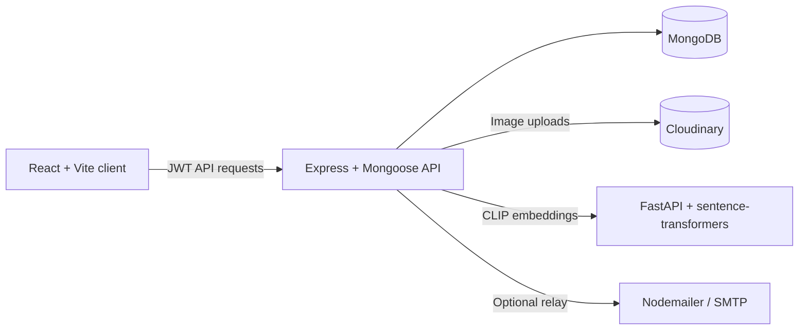

# TraceBack
TraceBack is a campus lost-and-found application that helps connect lost reports with found items, lets finders review owner claims, and provides an auditable admin approval flow.

## Architecture



## Requirements

- Node.js and npm
- Python 3.11 (recommended; Python 3.10+)
- MongoDB (local or Atlas)
- A Cloudinary account for report images
- Optional SMTP credentials to enable relayed email

## Setup (Windows PowerShell)

Create each service's local `.env` from its `.env.example`, then fill in your own values. Do not commit `.env` files. For Atlas, use a MongoDB **database user** and URL-encode special characters in its password once; do not encode the URI's separators.

### Backend

```powershell
cd server
npm install
if (-not (Test-Path .env)) { Copy-Item .env.example .env }
npm run dev
```

The API listens on the configured port (default `5000`). MongoDB must be reachable and its database credentials correct before the API can start.

### AI service

```powershell
cd ai-service
py -3.11 -m venv .venv
.\.venv\Scripts\Activate.ps1
python -m pip install -r requirements.txt
if (-not (Test-Path .env)) { Copy-Item .env.example .env }
python -m uvicorn main:app --reload --host 127.0.0.1 --port 8000
```

The first request that needs embeddings downloads the configured CLIP model if it is not already cached.

### Frontend

In another PowerShell window:

```powershell
cd client
npm install
if (-not (Test-Path .env)) { Copy-Item .env.example .env }
npm run dev
```

Open the local URL printed by Vite. The frontend API base URL is configured with `VITE_API_URL`.

## Seed data and matching check

From `server/`, run the seed script after MongoDB and the AI service are available:

```powershell
npm run seed
npm run test:matching
```

The seed command creates an administrator, demo owner and finder accounts, and 20 sample reports (10 lost and 10 found). Set `ADMIN_EMAIL` and an `ADMIN_PASSWORD` of at least 12 characters before seeding; the demo accounts use `SEED_USER_PASSWORD` or, if unset, the admin password. The matching check compares each seeded lost report against the found reports, prints its top match, and requires at least 80% top-1 accuracy.

## Matching formula

For each active lost/found pair, TraceBack computes:

```text
match% = 0.40 × imageSim
       + 0.30 × textSim
       + 0.10 × categoryMatch
       + 0.10 × locationSim
       + 0.10 × dateScore
```

Image and text similarities use normalized cosine similarity over CLIP embeddings. Image similarity uses the best photo pair. Category is an exact category match. Location is `1` for the same location, `0.5` for the same configured campus zone, otherwise `0`. Date score is `0` when the found date predates the lost date and decays with elapsed days. The API returns the total and component scores so the client can explain each match.

## API overview

All API routes are under `/api`.

| Area | Routes |
|---|---|
| Auth | `POST /auth/register`, `POST /auth/login`, `POST /auth/refresh`, `POST /auth/logout` |
| Lost reports | `GET/POST /lost`, `GET/PATCH /lost/:id`, `GET /lost/:id/matches`, `POST /lost/:id/close` |
| Found reports | `GET/POST /found`, `GET/PATCH /found/:id`, `GET /found/public` |
| Claims | `POST /claims`, `GET /claims/mine`, `GET /claims/finder`, `POST /claims/:id/finder-decision`, `POST /claims/:id/admin-decision` |
| Contact | `GET /claims/:id/contact`; optional `POST /claims/:id/messages` when relay is enabled |
| Admin | `GET /admin/stats`, `GET /admin/claims`, `GET /admin/users`, `PATCH /admin/users/:id/deactivate` |
| Notifications | `GET /notifications`, `PATCH /notifications/:id/read` |
| Health | `GET /api/health` |

Contact information is only available to an authorized participant after the claim's contact gate passes. Public found-item responses never include email addresses or hidden verification details. Resolved reports remain in history and are not included in active matches.

The AI service runs separately on port `8000` by default and exposes `GET /health`, `POST /embed-image` (`{ "image": "<base64>" }`), `POST /embed-text` (`{ "text": "..." }`), and `POST /similarity` (`{ "a": [...], "b": [...] }`).

## Tests

```powershell
cd server
npm test
cd ..\client
npm run lint
npm run build
cd ..\ai-service
python -m unittest discover -s tests
```

The CLIP model is relatively large; embedding-dependent checks require the model and a running AI service. Keep credentials and uploaded files out of source control.
